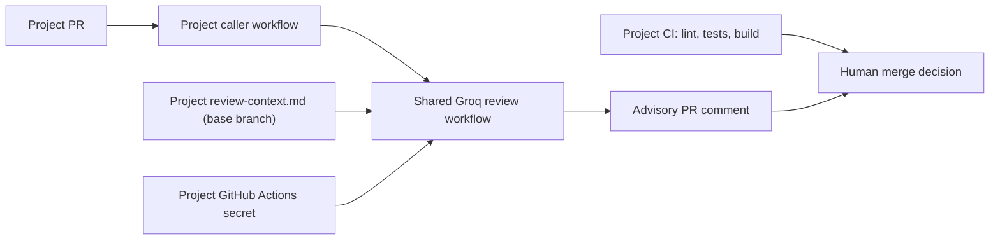

# Shared AI Review Workflows

Reusable, advisory AI code review for multiple GitHub repositories using GitHub Actions. This is a shared workflow, **not** an automatic merge gate.

## Architecture



### Consumer setup

Create `.github/workflows/ai-review.yml` in each consuming repository:

```yaml
name: AI Code Review
on:
  pull_request_target:
    types: [opened, reopened, synchronize, ready_for_review]
permissions:
  contents: read
  issues: write
  pull-requests: write
jobs:
  review:
    if: ${{ !github.event.pull_request.draft && github.event.pull_request.head.repo.full_name == github.repository }}
    uses: Helen869/shared-ai-review-workflows/.github/workflows/groq-review.yml@main
    secrets:
      GROQ__REVIEW_API_KEY: ${{ secrets.GROQ__REVIEW_API_KEY }}
```

Configure `GROQ__REVIEW_API_KEY` separately under each consumer repository's **Settings → Secrets and variables → Actions**.

Optionally keep `.github/ai-review-config.yml` with `provider: groq`. Add `.github/review-context.md` with project-specific facts and accepted tradeoffs.

### Security boundaries

- `pull_request_target` executes the **base branch** workflow. Only same-repository PRs are reviewed; fork PRs are skipped.
- The reviewer fetches PR patches through GitHub's API. It does **not** checkout or execute the PR branch.
- PR content is treated as untrusted; best-effort sensitive-file and secret-pattern filters are **not** a complete data-loss-prevention solution.
- PR patches and project context are sent to an external Groq API. Do not enable on confidential repositories without data-governance approval.
- The token is supplied by the calling repository. Neither tokens nor customer-specific context belong here.
- A generated PR comment is advisory. Human approval and deterministic CI remain separate.
- Each consumer should use a protected central release tag or pinned commit SHA for production; `@main` automatically receives central updates but is mutable.

### Current scope

One Groq model-based reviewer, with a limit of 35 files / 28,000 diff characters, retries for transient API failures, and one updated review comment per PR. Additional providers or advanced evaluation frameworks are deliberately out of scope.
